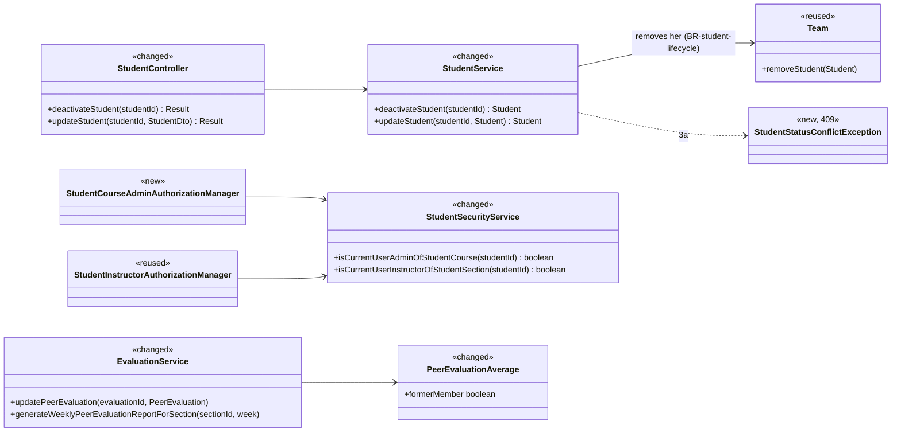
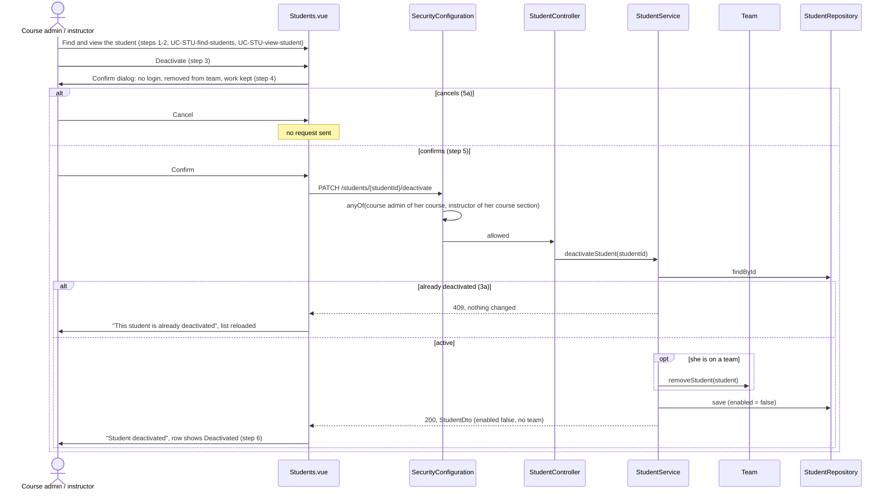
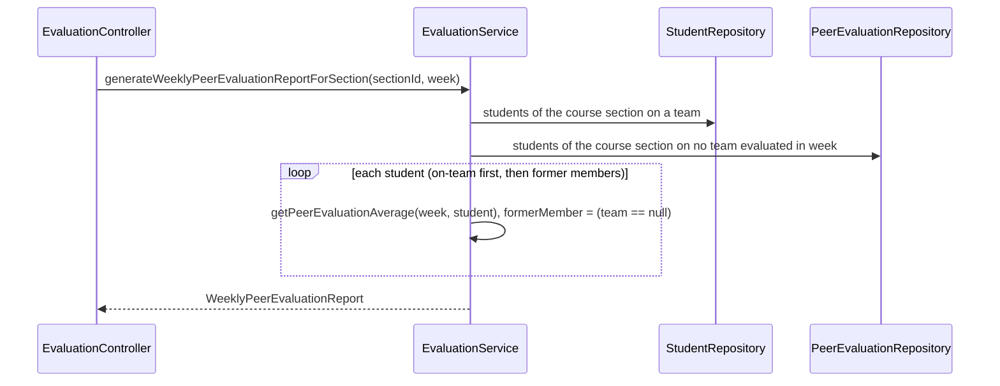

# Student (STU) Design

> Realizes: UC-STU-deactivate-student
> Depends on: FR-SEC-active-account, BR-student-lifecycle, BR-former-team-member, BR-team-admin-only, BR-team-assignment-required, BR-submission-owed, BR-section-scoped-access, CO-ferpa
> See: [use cases](../requirements/use-cases.md#student), [business rules](../requirements/business-rules.md), [SRS security requirements](../requirements/software-requirements-specification.md), [architectural-design.md](architectural-design.md#shared-foundation-components) (shared-foundation component view, Authorization, Security & Compliance)
> Designed against `main` at `59f0267` (2026-11-01).

## Overview

This area manages a student's account inside a course section. The other STU use cases (invite, find, view, delete) were built before this spec set and are mapped in [`../traceability.md`](../traceability.md); this doc starts with deactivation.

Deactivation used to be the `enabled` switch on the generic Edit Student form (`PUT /students/{studentId}`). That path had three problems. It skipped step 4's consequences warning. Its route rule admitted only instructors assigned to the course section, so an unassigned course admin was refused, contrary to BR-student-lifecycle. And it left the student on her team. The design gives deactivation its own action, which also removes her from her team. It also adjusts the two peer evaluation paths that a team change affects (BR-former-team-member): editing an evaluation, and the course section's weekly report.

Everything stays in the foundation `student` and `team` packages and the performance-tracking `evaluation` package, using existing patterns. There is no Level-1 change.

## Components & classes

Backend (`backend/src/main/java/team/projectpulse/`):

- `student/StudentController.java`: new `deactivateStudent`.
- `student/StudentService.java` (the class is `@Transactional`, so team removal and the status change commit together):
  - new `deactivateStudent`;
  - `updateStudent` may set `enabled` to true but never to false, and it applies `true` only when the caller is an instructor (`UserUtils.hasRole("ROLE_instructor")`, replacing today's `SecurityContextHolder` read). The route also admits the student herself, and her pre-deactivation token is still valid for up to 2 hours, so without this check she could reactivate herself.
- `student/converter/StudentDtoToStudentConverter.java`: unchanged. `StudentDto.enabled` is still read so that `true` can reactivate.
- `student/StudentSecurityService.java`: new `isCurrentUserAdminOfStudentCourse`, modeled on `InstructorSecurityService.isCurrentUserAdminOfInstructorCourse`. It returns false for an unknown id.
- `security/authorizationmanagers/`: new `StudentCourseAdminAuthorizationManager`, combined with the reused `StudentInstructorAuthorizationManager`; route rule in `security/SecurityConfiguration.java`.
- `system/exception/`: new `StudentStatusConflictException`, mapped to HTTP 409 with `StatusCode.CONFLICT` and the message "This student is already deactivated." in `ExceptionHandlerAdvice`.
- `src/main/resources/db/migration/`: a data-only Flyway migration that removes every already-deactivated student from her team (see Data model).
- `team/Team.java`: `removeStudent` is reused as is.
- `evaluation/EvaluationService.java`:
  - `addPeerEvaluation` is unchanged; its shared-team check already refuses an evaluatee with no team;
  - `updatePeerEvaluation` gains the same shared-team check: it fails when either the evaluator or the evaluatee is on no team, or when their team ids differ, so two students on no team never match;
  - `generateWeeklyPeerEvaluationReportForSection` adds former members.
- `evaluation/PeerEvaluationRepository.java`: one new finder for the distinct students whose course section is the report's, who are on no team, and who received at least one peer evaluation (from any evaluator, self-evaluation included) for the given week. Former members follow the on-team rows, ordered by last name and then first name; the on-team rows keep their current order.
- `evaluation/PeerEvaluationAverage.java`: new `formerMember`.

Frontend (`frontend/src/`):

- `apis/student`: new `deactivateStudent(id)`.
- `pages/students/Students.vue`:
  - a Deactivate button in Operations for active rows, behind an `ElMessageBox.confirm` (precedent: `pages/sections/Sections.vue`). The dialog lists every consequence in the use case's Associated Information (step 4):
    - she can no longer log in or submit weekly activity reports and peer evaluations;
    - she is removed from her team, and her teammates can no longer evaluate her;
    - her account and past work are kept, and she appears as a former member in the weekly peer evaluation report;
    - the account can be reactivated later, but that does not restore her team;
    - this is not deletion.
  - On success the page shows "Student deactivated." and reloads the list (step 6). On a 409 (3a) it shows no message of its own, because the shared Axios interceptor already shows the server's message "This student is already deactivated.", and it reloads the list;
  - the status tag reads **Active / Deactivated**, the spec's terms, instead of Enabled / Disabled.
- `pages/students/EditStudentForm.vue`: the status switch is replaced by a read-only status and, only for a deactivated student, a Reactivate control. That is today's reactivation path, kept until UC-STU-reactivate-student is designed.
- `pages/evaluations/admin/SectionsEvaluations.vue`: a "former member" tag beside the student's name when `formerMember` is true.
- `pages/teams/Teams.vue`: `studentsWithoutTeam` excludes deactivated students, so a deactivated student is not offered for assignment (backend guard: OI-66).

## Sequence

### UC-STU-deactivate-student: deactivate a student

### BR-former-team-member: the weekly peer evaluation report

## API contract

| Endpoint | Caller (who may) | Request | Success | Errors, by extension |
|---|---|---|---|---|
| `PATCH /students/{studentId}/deactivate` (new) | The course admin of the student's course, or an instructor assigned to the student's course section | none | 200, the `StudentDto` with `enabled: false` and no team | 3a: 409, already deactivated, nothing changed. Any other caller, including the student herself, or an id that names no student: 403 from the route rule |
| `PUT /students/{studentId}` (changed) | unchanged | `enabled: false` is ignored; `enabled: true` reactivates | unchanged | unchanged |
| `PUT /evaluations/{evaluationId}` (changed) | unchanged | unchanged | unchanged | 400 "The evaluator and evaluatee must be on the same team." when the evaluatee has left the evaluator's team |
| `GET /evaluations/sections/{sectionId}/week/{week}` (changed) | unchanged | unchanged | each `PeerEvaluationAverage` gains `formerMember`; former members evaluated that week are included | unchanged |

## Key decisions

- **Deactivation is its own action, not a field on the generic update.** The generic `PUT` can't carry step 4's warning, and its route rule is owner-or-self. Rejected: keeping `enabled` on `PUT /students/{studentId}`. The generic update keeps only the `true` direction, so reactivation still works until UC-STU-reactivate-student is designed. Rejected: removing `enabled` from it entirely, which would leave no way to reactivate.
- **Who may: `anyOf(StudentCourseAdmin, StudentInstructor)`**, per BR-student-lifecycle. The course admin is matched through the student's course (`section.course.courseAdmin`), not through assignment, so an unassigned course admin passes. Rejected: `UserOwnershipAuthorizationManager`, which refuses that course admin and admits the student herself. The route is flat and names one student, whom the route rule has already resolved, so the service has no second id to scope.
- **Deactivation removes her from her team, in the same transaction.** Rejected: keeping her on the team and filtering on `enabled` in every team-scoped query, roster, and form. That needs a second predicate everywhere, and one missed predicate shows her as a member. Removal has a useful side effect. A bearer token issued before deactivation stays valid for up to 2 hours (FR-SEC-active-account), but with no team that token can't submit a weekly activity report or a peer evaluation (BR-team-assignment-required), and it can't pass a team-membership route rule into RAM.
- **"Former member" is computed as "on no team now", not stored.** The history we need is already recorded: received peer evaluations carry their week, and an `Activity` has its own `team` foreign key set at submission. Rejected: a team-membership history table, which would be a schema change for a label. Two consequences follow:
  - The rule covers plain removal (UC-TEA-remove-student) as well as deactivation, because the code can't tell them apart and the meaning is the same. That is why it is BR-former-team-member and not part of BR-student-lifecycle.
  - A student moved to *another* team appears under her current team, not as a former member, and that week's averages include every evaluation she received. She is still listed for that week, so the report hides nothing. The label applies only when she is on no team, which is the state BR-former-team-member describes as having left.
- **Editing an evaluation of a former member is refused too, not only creating one.** Without it, a teammate could keep rewriting an evaluation of her while the submission window is still open after she leaves. Rejected: letting edits through because the evaluation predates her leaving. `updatePeerEvaluation` re-runs the shared-team check that `addPeerEvaluation` already makes.
- **A repeat deactivation is a 409, not a silent success.** A stale list would otherwise report a change that did not happen (3a). Rejected: an idempotent 200. The Deactivate button appears only on active rows, so 3a can arise only from a stale list, and the server reports it after the confirmation rather than at step 3. The outcome is the one 3a requires: no change, and the actor is told.
- **The control lives on the student list.** `Students.vue` and its edit dialog are the existing UC-STU-view-student surface (see its traceability row), so the list row is where step 2 leaves the actor. Rejected: a separate student detail page, which doesn't exist and isn't needed.

## Data model

No schema delta, but one **data** migration. The old toggle deactivated students without removing them from their teams, so `staging` and `prod` may hold deactivated students still on a team. The new `V<n>__remove_deactivated_students_from_teams.sql` sets the team to null for every student whose account is disabled, which brings existing data in line with BR-student-lifecycle and lets BR-former-team-member label them. `dev` reseeds every student as active, so it needs nothing. Rejected: leaving the old rows as they are, which would keep those students on rosters and on the peer evaluation form.

 The data already exists: the user's `enabled` column, the student's `team` foreign key, and the activity's `team` foreign key. `formerMember` is a computed DTO field. The shared model is in the SRS's Business Domain Model.

## Reuse & cross-cutting

- **Authorization:** the `AuthorizationManager` + `*SecurityService` pattern, and `AuthorizationManagers.anyOf` as the reminder routes use it ([Authorization](architectural-design.md#authorization)).
- **Login denial:** `MyUserPrincipal.isEnabled()` is unchanged; Spring Security refuses a disabled account at authentication (FR-SEC-active-account).
- **Team membership:** `Team.removeStudent`, the same call UC-TEA-remove-student uses.
- **Who owes what:** `SubmissionStatusService` (BR-submission-owed) already skips students on no team or deactivated, so reminders and owed lists need no change ([not.md](not.md)).
- **History views that already keep a former member:**
  - weekly activity reports by team: `Activity.team` is fixed at submission;
  - per-student admin pages: keyed by student id, and `getPeerEvaluationAverage` is already null-team safe.

## Tests

| Use case, flow | Level | Asserts |
|---|---|---|
| UC-STU-deactivate-student, main, assigned instructor | integration | 200; the student's `enabled` is false and her team is null; the team's roster no longer lists her; her login is refused (401) |
| main, unassigned course admin | integration | A course admin not assigned to the student's course section gets 200 |
| main, student on no team | unit | Deactivates without touching any team |
| 3a | unit + integration | An already deactivated student gives 409; status and team unchanged |
| 5a | none | UI-only (Cancel sends no request); these pages have no frontend test harness |
| route rule | integration | The student herself, another student, and an instructor of another course section get 403; an id that names no student gets 403 |
| work kept | integration | After deactivation her weekly activity reports and the peer evaluations she gave and received still exist |
| weekly activity reports by team (BR-former-team-member) | integration | Searching activities by her former team's id still returns her past weekly activity reports |
| peer evaluation, create (BR-former-team-member) | integration | A former teammate's new peer evaluation of her gives 400 "same team" |
| peer evaluation, edit (BR-former-team-member) | unit + integration | Editing an existing evaluation of her after she leaves gives 400; editing an evaluation of a current teammate still succeeds |
| peer evaluation form (BR-former-team-member) | integration | `GET /students/teams/{teamId}` no longer lists her |
| report, week she received evaluations (BR-former-team-member) | unit + integration | Her row is present with `formerMember: true` and that week's averages |
| report, week she received none | unit | No row for her |
| report, current members | unit | Rows unchanged, with `formerMember: false` |
| generic update | unit + integration | `PUT /students/{studentId}` with `enabled: false` leaves her active; an assigned instructor's `enabled: true` on a deactivated student reactivates her without restoring a team; the student's own `PUT` with `enabled: true`, using a token issued before deactivation, leaves her deactivated |
| peer evaluation, edit, both on no team (BR-former-team-member) | unit | An evaluator on no team cannot edit an evaluation of an evaluatee on no team |
| report, former members ordering | unit | Former members follow on-team rows, by last name then first name |
| data migration | manual, on staging | Integration tests run the `dev` profile, which builds the schema with `ddl-auto: create` and never runs Flyway. So before and after the migration on staging, query for disabled students with a team: the count drops to zero, and active students keep their teams |

## Open questions / risks

- A token issued before deactivation stays valid for up to 2 hours (accepted; FR-SEC-active-account). Team removal leaves it effectively read-only for her own data.
- A deactivated student may still hold a RAM document-section lock until it lapses (BR-lock-expiry). Accepted.
- `TeamService.assignStudentToTeam` still accepts a deactivated student through the API (OI-66).
- `DELETE /students/{studentId}` admits the student herself, contrary to BR-student-lifecycle (OI-65); out of scope here.
